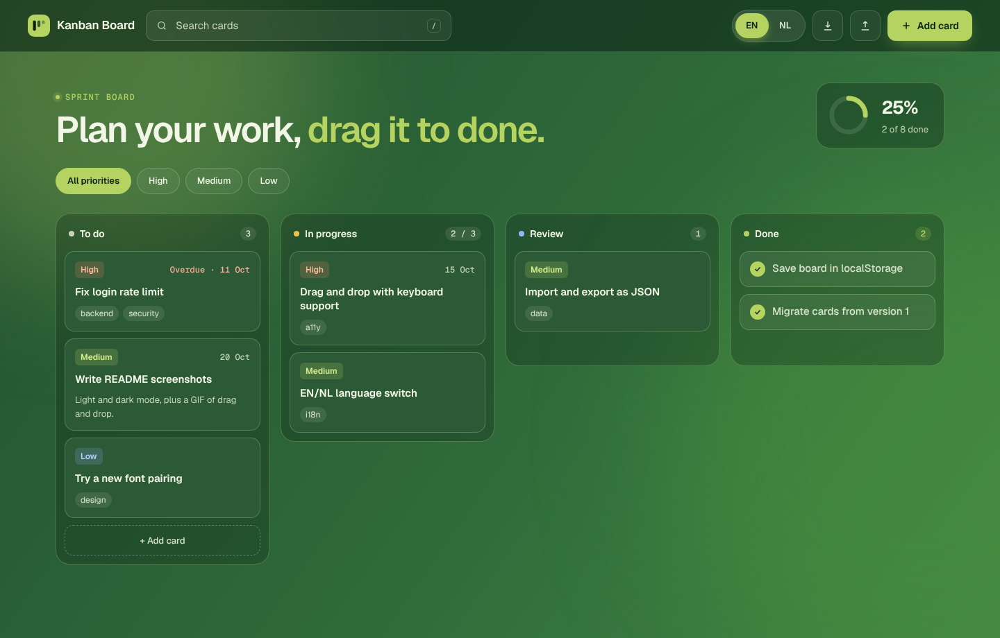
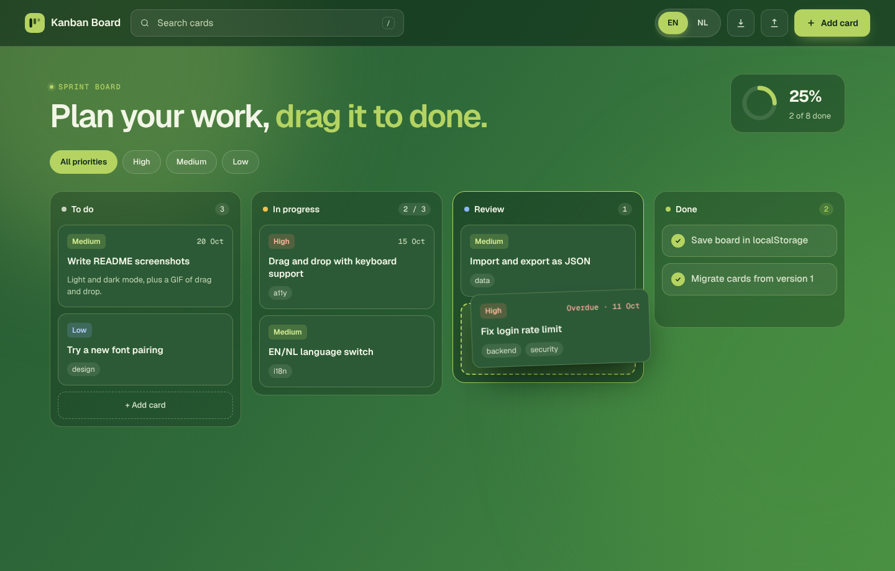
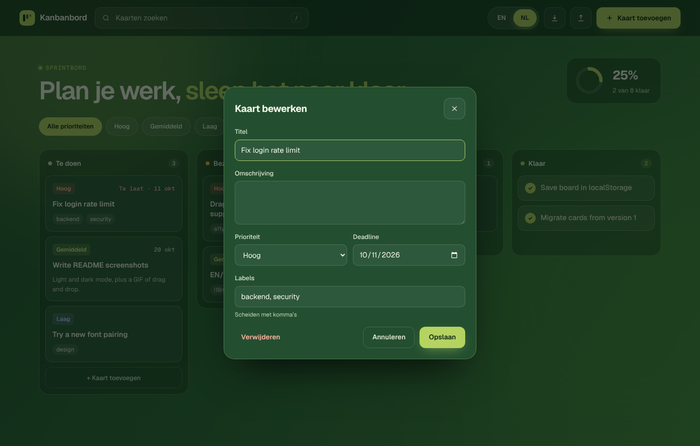
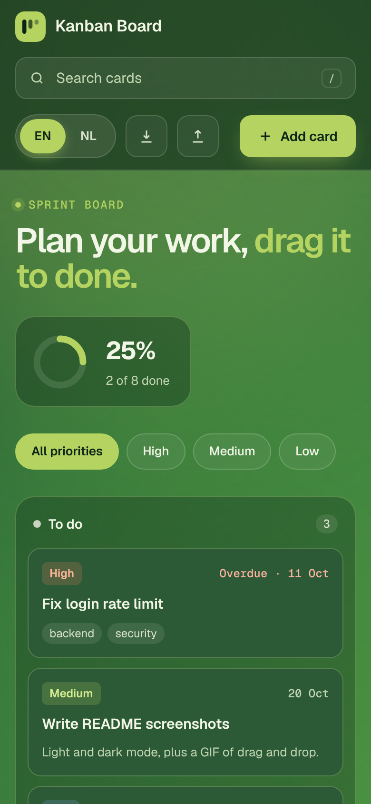

# Kanban Board

A kanban board for planning your own work. Add cards, drag them from *To do* to *Done*, and switch the whole interface between English and Dutch.

Built with plain HTML, CSS and JavaScript modules. No framework and no build step.

**Live demo:** https://ahmetr42.github.io/kanban-board/



## Features

- **Drag and drop** with the mouse, or with a short press on touch screens.
- **Keyboard support**: focus a card, press <kbd>Space</kbd> to pick it up, move it with the arrow keys, and press <kbd>Space</kbd> again to drop it. <kbd>Escape</kbd> cancels. Screen readers hear every step.
- **Cards** have a title, description, priority, due date and tags. Overdue cards are marked.
- **Search and filter** by text, tag or priority. Press <kbd>/</kbd> to jump to the search box.
- **Work-in-progress limit**: the board warns you when more than 3 cards are in progress.
- **Undo** after deleting a card or importing a board.
- **Import and export** the board as a JSON file.
- **Saved automatically** in `localStorage`. Boards from the first version of this app are converted on the first visit.
- **English and Dutch**, with an animated language toggle. The choice is remembered.
- Works on phones, respects *reduced motion*, and has visible focus styles.

| Dragging a card | Editing a card (Dutch) |
| --- | --- |
|  |  |

<p align="center"></p>

## Run it locally

The app uses JavaScript modules, so it needs a small web server (opening `index.html` directly will not work).

```bash
git clone https://github.com/AhmetR42/kanban-board.git
cd kanban-board
npm start            # serves the app on http://localhost:5173
```

Any static server works, for example `python3 -m http.server 5173`.

## Tests

The board logic lives in pure functions without the DOM, so it can be tested with Node's built-in test runner. No packages need to be installed.

```bash
npm test
```

The tests cover adding, editing, moving and deleting cards, overdue dates, filtering, the WIP limit, progress, importing old data, and that the English and Dutch texts have the same keys.

## Project structure

```
index.html        page markup
css/styles.css    all styling, including the animated background
js/board.js       board logic (pure functions, fully tested)
js/i18n.js        English and Dutch texts
js/main.js        rendering, drag and drop, keyboard, storage
js/sample.js      example cards for the first visit
tests/            node --test files
```

## How it works

- Every change goes through a function in `board.js` that takes the current state and returns a new one. `main.js` saves the new state and renders the board again.
- Drag and drop uses Pointer Events, so mouse, pen and touch share one code path. A floating copy follows the pointer while a placeholder shows where the card will land.
- Text is looked up with `t(key, locale)`. Elements with a `data-i18n` attribute are updated when the language changes.

## License

[MIT](LICENSE)
